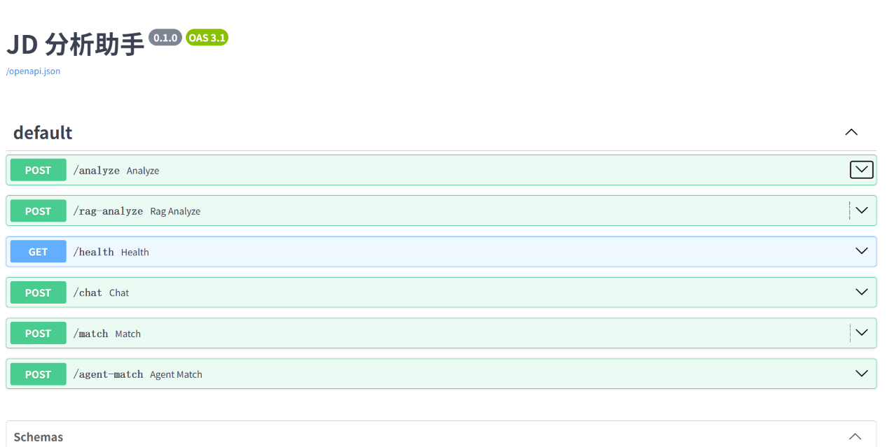
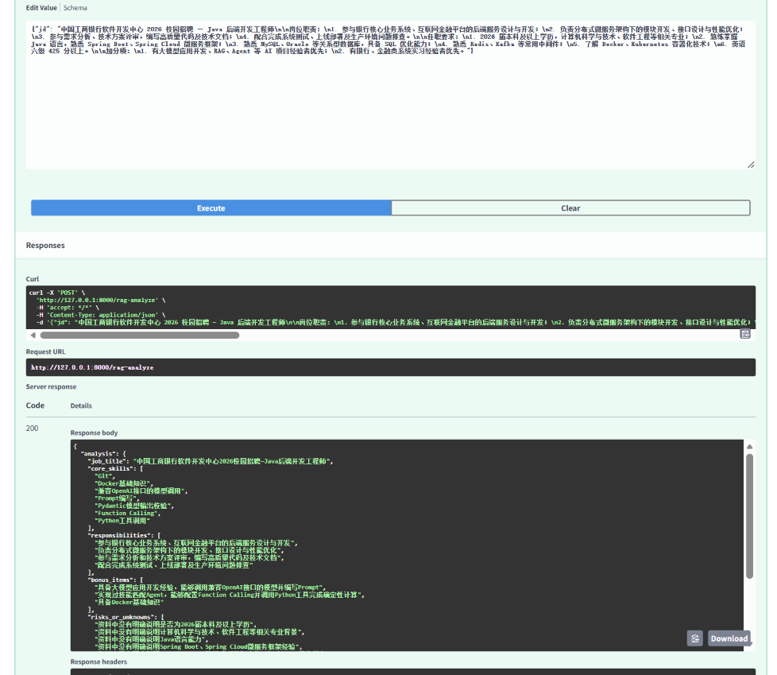
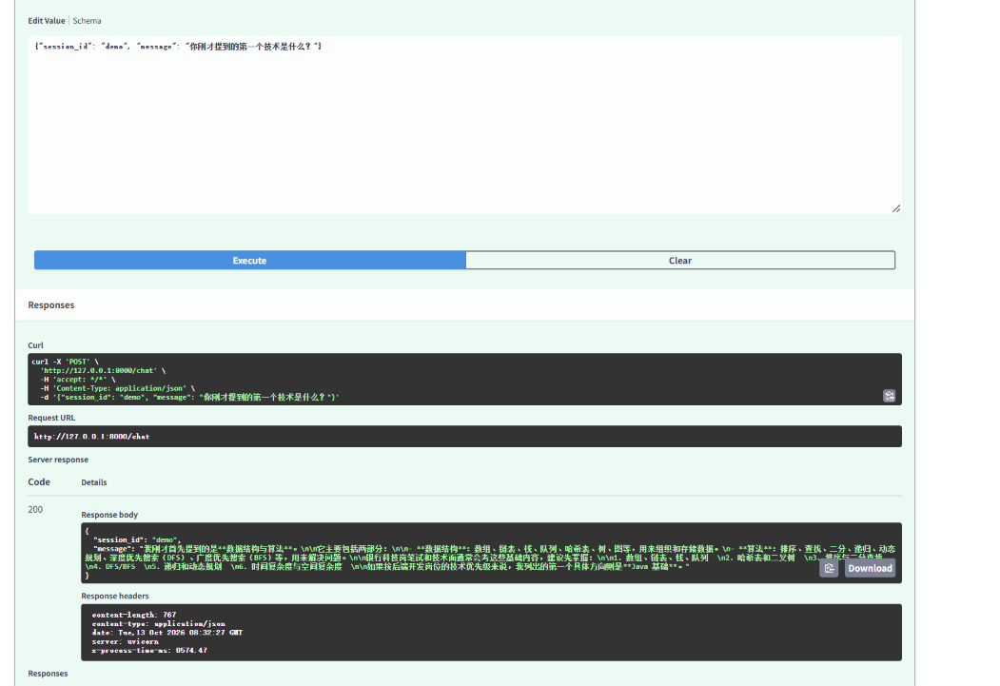
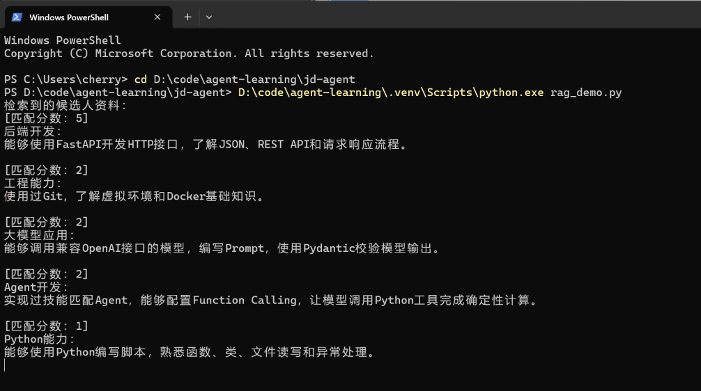

# JD Agent — 基于 LLM 的职位分析助手

一个基于 **FastAPI + 大模型 API** 的智能职位分析服务，集成 **RAG 检索增强**、**Function Calling 工具调用**、**SQLite 会话记忆**等 LLM 应用核心技术，可将非结构化的职位描述（JD）解析为结构化数据，并计算候选人与岗位的技能匹配度。

## 功能特性

| 功能 | 说明 | 涉及技术 |
|------|------|----------|
| JD 结构化分析 | 将职位描述解析为岗位名称、核心技能、职责、加分项、风险项 | Prompt Engineering + Pydantic 输出校验 |
| RAG 增强分析 | 先检索候选人资料，再基于检索结果生成匹配分析，避免模型编造 | 关键词检索 + 上下文注入 |
| 技能匹配计算 | 计算候选人技能与岗位要求的匹配分数、已匹配/缺失技能清单 | Function Calling |
| 多轮对话 | 带会话记忆的求职问答助手，支持多 session 隔离 | SQLite 持久化存储 |
| 健壮性设计 | 模型超时/连接失败自动重试，结构化输出校验失败返回 502 | 异常处理 + 重试机制 |
| 性能观测 | 响应头自动附带处理耗时（`X-Process-Time-ms`） | FastAPI 中间件 |

## 技术栈

- **语言**：Python 3.13
- **Web 框架**：FastAPI + Uvicorn
- **数据校验**：Pydantic（模型输出结构化校验）
- **LLM 接入**：OpenAI 兼容 API（Chat Completions + Function Calling）
- **存储**：SQLite（会话记忆）
- **部署**：Docker

## 项目结构

```
jd-agent/
├── api.py                  # FastAPI 主服务（全部 API 端点）
├── main.py                 # 命令行版 JD 分析演示
├── rag_demo.py             # RAG 检索演示（关键词匹配召回）
├── tool_demo.py            # Function Calling 工具调用演示
├── memory_demo.py          # 内存版会话记忆演示
├── sqlite_memory_demo.py   # SQLite 持久化记忆演示
├── evaluate.py             # 模型输出评估脚本
├── evaluation_report.py    # 评估报告生成
├── measure_latency.py      # 接口延迟测量
├── test_api.py             # API 自动化测试
├── test_rag.py             # RAG 模块测试
├── jd.txt                  # 示例职位描述
├── profile.txt             # 示例候选人资料
├── Dockerfile              # 容器化部署
└── requirements.txt        # Python 依赖
```

## 快速开始

### 1. 环境准备

```powershell
# 创建虚拟环境
python -m venv .venv
.\.venv\Scripts\Activate.ps1

# 安装依赖
pip install -r requirements.txt
```

### 2. 配置环境变量

在项目根目录创建 `.env` 文件：

```env
OPENAI_API_KEY=你的API密钥
OPENAI_BASE_URL=https://api.openai.com/v1
OPENAI_MODEL=gpt-4o-mini
```

> 支持任何 OpenAI 兼容接口（DeepSeek、Moonshot、本地 vLLM 等），只需修改 `OPENAI_BASE_URL` 和 `OPENAI_MODEL`。

### 3. 启动服务

```powershell
uvicorn api:app --reload --port 8000
```

启动后访问交互式 API 文档：<http://127.0.0.1:8000/docs>

## API 使用说明

### 健康检查

```powershell
curl http://127.0.0.1:8000/health
```

### 1. JD 结构化分析 `POST /analyze`

将职位描述解析为结构化 JSON：

```powershell
curl -X POST http://127.0.0.1:8000/analyze `
  -H "Content-Type: application/json" `
  -d '{"jd": "招聘Java后端开发工程师，熟悉Spring Boot、MySQL、Redis..."}'
```

返回示例：

```json
{
  "job_title": "Java后端开发工程师",
  "core_skills": ["Java", "Spring Boot", "MySQL", "Redis"],
  "responsibilities": ["负责后端服务设计与开发", "..."],
  "bonus_items": ["有分布式系统经验者优先"],
  "risks_or_unknowns": ["未说明薪资范围"]
}
```

### 2. RAG 增强分析 `POST /rag-analyze`

先从 `profile.txt` 检索相关候选人资料，再结合资料生成分析（防止模型编造经历）：

```powershell
curl -X POST http://127.0.0.1:8000/rag-analyze `
  -H "Content-Type: application/json" `
  -d '{"jd": "招聘计算机视觉工程师，熟悉YOLO目标检测..."}'
```

返回中额外包含 `sources` 字段，标明分析依据的资料来源。

### 3. 技能匹配 `POST /match`（纯计算）

```powershell
curl -X POST http://127.0.0.1:8000/match `
  -H "Content-Type: application/json" `
  -d '{"required_skills": ["Java", "MySQL", "Redis"], "candidate_skills": ["Java", "MySQL", "Python"]}'
```

返回：`{"score": 67, "matched_skills": ["Java", "MySQL"], "missing_skills": ["Redis"]}`

### 4. Agent 技能匹配 `POST /agent-match`（Function Calling）

与 `/match` 结果相同，但计算过程由**模型自主决定调用工具**完成，演示 Agent 的工具使用能力。

### 5. 多轮对话 `POST /chat`（带记忆）

```powershell
# 第一轮
curl -X POST http://127.0.0.1:8000/chat `
  -H "Content-Type: application/json" `
  -d '{"session_id": "user001", "message": "我想应聘银行科技岗，该怎么准备？"}'

# 第二轮（同一 session_id，模型记得上文）
curl -X POST http://127.0.0.1:8000/chat `
  -H "Content-Type: application/json" `
  -d '{"session_id": "user001", "message": "那我刚才说的岗位需要哪些技术栈？"}'
```

对话历史持久化存储在 SQLite（`memory.db`），按 `session_id` 隔离不同会话。

## 运行截图

<!-- 截图存放约定：在项目下新建 docs/screenshots/ 目录，截图放进去后替换下方路径 -->

### Swagger 交互式文档


### JD 分析接口返回


### 多轮对话记忆效果


### RAG 检索命中结果


> **截图方法**：启动服务后打开 `http://127.0.0.1:8000/docs`，展开任意接口点 "Try it out" 执行，对结果页面截图，保存到 `docs/screenshots/` 目录即可正常显示。

## 评估与测试

```powershell
# API 自动化测试（需先启动服务）
python test_api.py

# RAG 模块测试
python test_rag.py

# 模型输出质量评估（生成 evaluation_report.json）
python evaluate.py
python evaluation_report.py

# 接口延迟测量
python measure_latency.py
```

## Docker 部署

```powershell
# 构建镜像
docker build -t jd-agent .

# 运行容器（注入环境变量）
docker run -d -p 8000:8000 `
  -e OPENAI_API_KEY=你的API密钥 `
  -e OPENAI_BASE_URL=https://api.openai.com/v1 `
  -e OPENAI_MODEL=gpt-4o-mini `
  --name jd-agent jd-agent
```

## 技术要点

- **结构化输出保障**：Prompt 约束 + Pydantic `model_validate_json` 双重校验，模型返回非法 JSON 时返回 502 而非崩溃
- **RAG 防幻觉**：`/rag-analyze` 强制模型仅基于检索到的资料作答，无证据时要求明确说明"资料中没有明确说明"
- **失败重试**：Function Calling 接口对超时/连接错误自动重试一次，连续失败返回明确错误码（504/502）
- **记忆持久化**：会话历史落盘 SQLite，服务重启不丢失

## License

MIT
